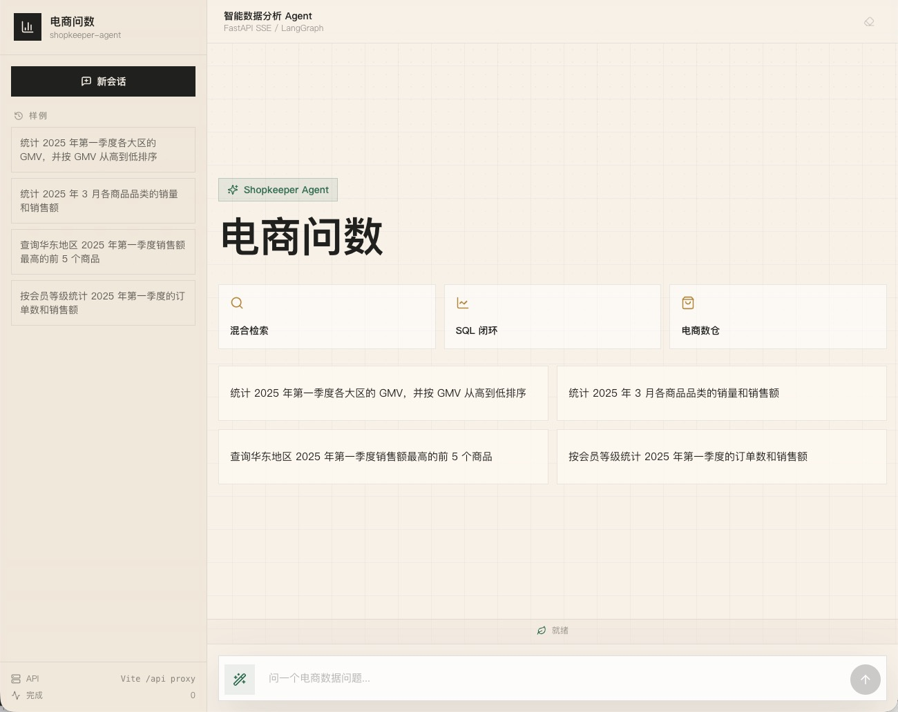
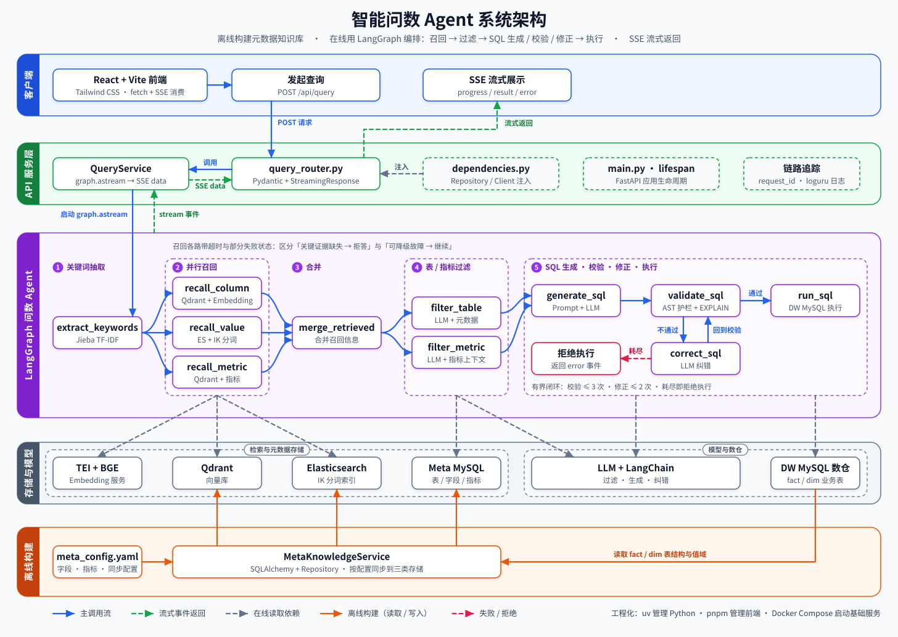
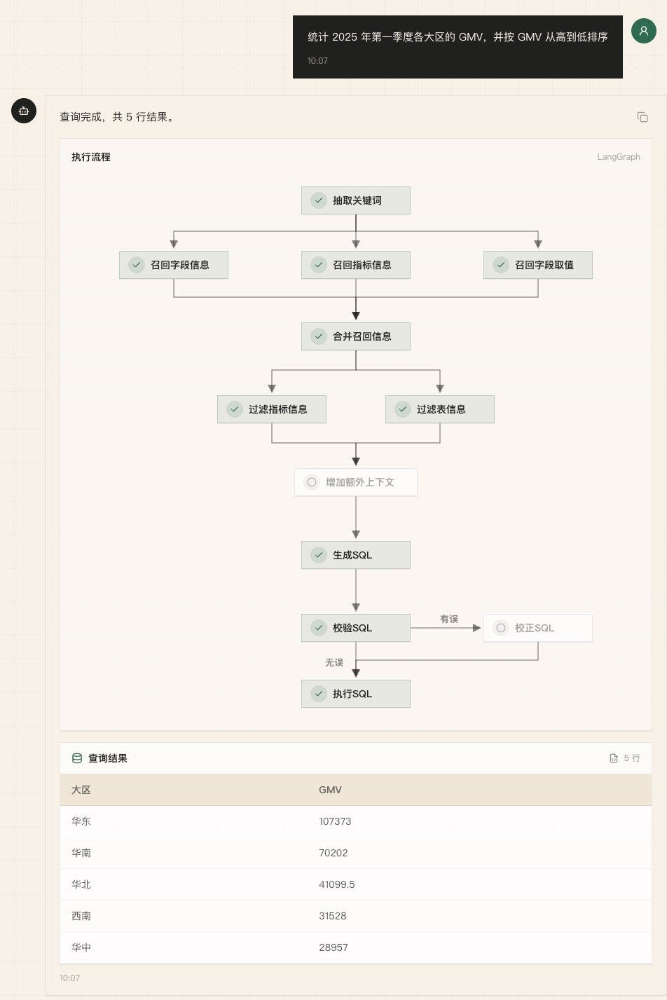

<div align="center">
  <h1 style="margin-top: 15px;">onlylo-nl2sql-agent：面向电商分析场景的自然语言问数 Agent</h1>
  <h4><b>onlylo-nl2sql-agent</b></h4>
  <p><em>A reliability-oriented Text-to-SQL agent with hybrid retrieval, evidence-aware routing, SQL governance, and reproducible evaluation.</em></p>
</div>

<div align="center">


[快速开始](#quick-start) • [项目亮点](#features) • [系统架构](#architecture) • [评测与文档](#evaluation) • [来源与许可证](#source-and-license)

</div>

本项目探索如何将自然语言问题转换为可验证、可约束、可执行的 SQL 查询，重点关注混合检索、证据完整性、SQL 安全边界、失败隔离和可复现评测。

这是一个可运行的 Text-to-SQL 工程原型，面向电商分析场景提供从元数据知识库构建、自然语言检索、SQL 生成与治理，到 API / SSE 结果返回的完整最小链路。



<a id="project-introduction"></a>

## 📖 项目介绍

在真实问数场景里，业务同学通常不会写 SQL，数据分析同学也很难随时记住所有表结构、字段含义、指标口径和字段取值。单纯把自然语言问题直接交给大模型，很容易出现表选错、字段选错、指标理解错和 SQL 幻觉等问题。

`电商问数` 要解决的就是这个问题：

- 用户用自然语言提问
- 系统自动召回相关字段、指标和字段取值
- 大模型基于上下文进行分步推理
- 生成 SQL 并查询数据仓库
- 以流式方式返回分析结果

<a id="features"></a>

## ✨ 项目亮点

- **混合检索**：字段、指标、字段值并行召回，分别使用向量检索、全文检索和结构化元数据。
- **证据驱动决策**：关键证据不足时阻断 SQL 生成或执行，避免把不完整上下文直接交给模型。
- **SQL 治理边界**：对只读语句、表字段白名单、结果上限和行范围施加约束，并为并行召回设置超时预算。
- **失败隔离**：单路召回或外部依赖异常时进行隔离，并区分部分召回与整体失败。
- **有界修正**：对可修复的 SQL 错误执行有限次数的修正，并在执行前重新校验。
- **可复现评测**：将成功、阻断、未知和执行失败分开记录，便于定位问题而不是只统计最终成功率。
- **完整最小链路**：从知识库构建、自然语言查询到 FastAPI / SSE 流式返回，代码可以按 README 逐步启动。

<a id="architecture"></a>

## 🏗️ 系统架构



项目围绕两条主线展开：

| 主线             | 做什么                                                                   | 涉及模块                                     |
| ---------------- | ------------------------------------------------------------------------ | -------------------------------------------- |
| 元数据知识库构建 | 抽取教学数仓中的表、字段、指标和字段取值，写入结构化库、向量库和全文索引 | `MySQL` / `Qdrant` / `Elasticsearch` / `TEI` |
| 自然语言问数     | 基于用户问题完成召回、上下文整理、SQL 生成校验执行，并把过程流式返回前端 | `LangGraph` / `FastAPI` / `SSE` / `React`    |



## 🛠️ 项目技术栈

| 模块       | 技术                              | 作用                                           |
| ---------- | --------------------------------- | ---------------------------------------------- |
| 教学数仓   | `MySQL`                           | 模拟事实表、维度表和分析型查询环境             |
| 元数据库   | `MySQL` / `SQLAlchemy`            | 保存表、字段、指标、字段指标关系等结构化元数据 |
| 向量检索   | `Qdrant`                          | 保存字段和指标向量，支持语义召回               |
| 全文检索   | `Elasticsearch`                   | 保存字段真实取值，支持关键词和值域检索         |
| Embedding  | `TEI` / `BAAI/bge-large-zh-v1.5`  | 将字段、指标、问题等文本转成向量               |
| 智能体编排 | `LangGraph`                       | 组织多阶段问数工作流                           |
| 模型接入   | `LangChain`                       | 封装 LLM 与 Embedding 调用                     |
| 后端接口   | `FastAPI`                         | 提供问数 API、依赖注入和生命周期管理           |
| 流式协议   | `SSE`                             | 实时返回节点进度、查询结果和错误消息           |
| 治理策略   | `sqlglot` / AST                   | 只读 SQL、表字段白名单、结果上限和行范围约束   |
| 前端       | `React` / `Vite` / `Tailwind CSS` | 提供聊天式问数界面和流程展示                   |
| 日志追踪   | `ContextVar` / `loguru`           | 为并发请求注入 request_id，便于排查链路        |
| 依赖管理   | `uv` / `pnpm`                     | 管理 Python 后端和前端依赖                     |

## 📁 项目结构

```text
onlylo-nl2sql-agent/
├── app/
│   ├── agent/            # LangGraph 图、状态、上下文和各类节点
│   ├── api/              # FastAPI 路由、依赖注入、生命周期和请求结构
│   ├── clients/          # MySQL、Qdrant、Elasticsearch、Embedding 客户端管理
│   ├── conf/             # 配置 dataclass 与配置加载工具
│   ├── core/             # 日志、request_id 上下文等通用能力
│   ├── entities/         # 更贴近业务语义的数据对象
│   ├── models/           # SQLAlchemy ORM 模型
│   ├── prompt/           # Prompt 加载工具
│   ├── repositories/     # MySQL、Qdrant、Elasticsearch 数据访问层
│   ├── scripts/          # 元数据知识库构建脚本
│   └── services/         # 元数据构建服务和问数查询服务
├── conf/                 # app_config.yaml、meta_config.yaml
├── docker/               # Docker Compose、MySQL 初始化 SQL、Embedding 挂载目录
├── frontend/             # React + Vite + Tailwind CSS 前端项目
├── prompts/              # SQL 生成、修正、过滤等 Prompt 模板
├── eval/                 # 离线评测、真实服务诊断入口与公开测试夹具
├── tests/                # 不调用外部服务的 unittest 回归测试
├── main.py               # FastAPI 应用入口
└── pyproject.toml        # Python 项目依赖与工具配置
```

<a id="quick-start"></a>

## 🚀 快速开始

仓库提供本地开发配置与初始化脚本；需要自行准备模型文件和 LLM 服务，按以下顺序启动项目。

### 1. 准备环境

- Python `>= 3.14`
- `uv`
- Docker 与 Docker Compose
- Node.js 与 `pnpm`

### 2. 克隆项目

```bash
git clone <REPOSITORY_URL>
cd onlylo-nl2sql-agent
```

### 3. 安装后端依赖

```bash
uv sync --frozen
```

### 4. 配置大模型 API Key

```bash
cp .env.example .env
```

把 `.env` 中的模型名、API Key 和兼容 OpenAI 的 Base URL 替换成你自己的配置：

```bash
LLM_MODEL=your_model_name
LLM_API_KEY=your_real_api_key
LLM_BASE_URL=https://your-openai-compatible-endpoint/v1
```

应用配置通过 OmegaConf 的 `oc.env` 读取环境变量：

```yaml
llm:
    model_name: ${oc.env:LLM_MODEL}
    api_key: ${oc.env:LLM_API_KEY}
    base_url: ${oc.env:LLM_BASE_URL}
```

真实 API Key、Base URL 和本地 `.env` 不应提交到 Git。

### 5. 准备 Embedding 模型

项目通过 `TEI` 加载 `BAAI/bge-large-zh-v1.5`。模型文件体积较大，不随仓库提交，需要先下载到 Docker 挂载目录：

```bash
uv run hf download BAAI/bge-large-zh-v1.5 --local-dir docker/embedding/bge-large-zh-v1.5
```

如果手动下载，请解压到：`docker/embedding/bge-large-zh-v1.5`路径下。

### 6. 启动 Docker 基础服务

```bash
docker compose -f docker/docker-compose.yaml up -d
```

默认端口：

| 服务          | 端口   |
| ------------- | ------ |
| MySQL         | `3306` |
| Elasticsearch | `9200` |
| Kibana        | `5601` |
| Qdrant        | `6333` |
| Embedding     | `8081` |

> `docker/mysql/meta.sql` 和 `docker/mysql/dw.sql` 会在 MySQL 容器首次启动时自动初始化元数据库和教学数仓。

### 7. 构建元数据知识库

```bash
uv run python -m app.scripts.build_meta_knowledge -c conf/meta_config.yaml
```

这一步会把表字段元数据写入 MySQL，把字段和指标向量写入 Qdrant，并把字段真实取值写入 Elasticsearch。

### 8. 启动后端

```bash
uv run fastapi dev main.py
```

后端接口：

```text
POST http://127.0.0.1:8000/api/query
```

请求示例：

```json
{
    "query": "统计华北地区的销售总额"
}
```

SSE 消息类型：

| 类型       | 含义         |
| ---------- | ------------ |
| `progress` | 节点执行进度 |
| `result`   | 最终查询结果 |
| `error`    | 全局异常消息 |
| `recall_decision` | 证据决策与阻断原因；允许继续时不代表查询已成功 |
| `terminal` | SQL 链路终态：`success` / `blocked` / `error`；成功终态不覆盖已有结果 |

### 9. 启动前端

```bash
cd frontend
pnpm install
pnpm dev
```

前端默认通过 Vite 代理把 `/api` 转发到 `http://127.0.0.1:8000`。如需修改：

```bash
cp .env.example .env
```

```bash
VITE_DEV_PROXY_TARGET=http://127.0.0.1:8000
```

前后端就绪后，打开前端终端显示的本地地址，输入“统计华北地区的销售总额”，检查节点进度、SQL 和结果。证据不足或策略不允许时，应返回阻断结果，不代表查询成功。

<a id="evaluation"></a>

## 🧪 评测与文档

- [评测说明](eval/README.md)：评测数据、运行方式和结果解释。
- [文档导航](docs/index.md)：架构图、SQL 行范围契约与测试入口。
- [中文架构图备用草稿](docs/architecture/onlylo-nl2sql-agent-architecture-cn-draft-v2.html)：业务流程草稿，不作为当前正式架构图。

<a id="source-and-license"></a>

## 📎 项目来源与许可证

本项目基于 [didilili/shopkeeper-agent](https://github.com/didilili/shopkeeper-agent) 的 MIT 许可代码演进而来。新仓库保留原项目的 `LICENSE`、版权声明和必要的来源说明，并围绕混合检索、证据决策、SQL 治理、失败隔离和可复现评测重新整理项目结构与文档。

本仓库不沿用上游的完整教程目录、社群推广内容或原提交历史；上游来源和许可证边界以仓库中的 `LICENSE` 文件为准。
